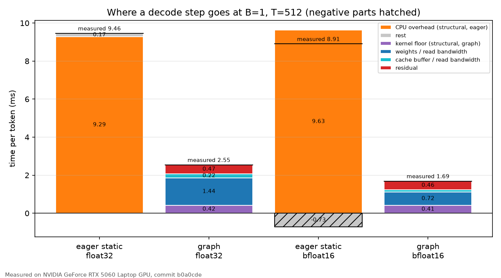
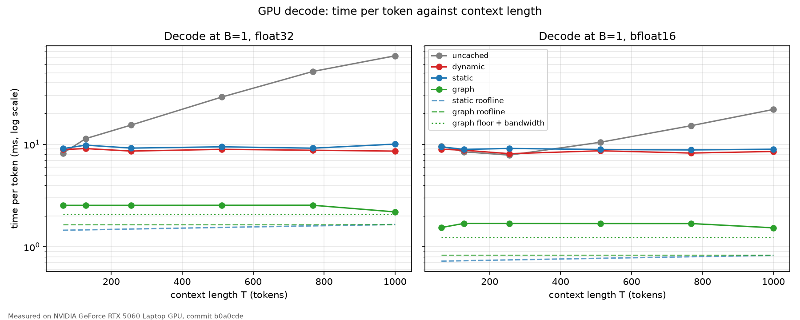
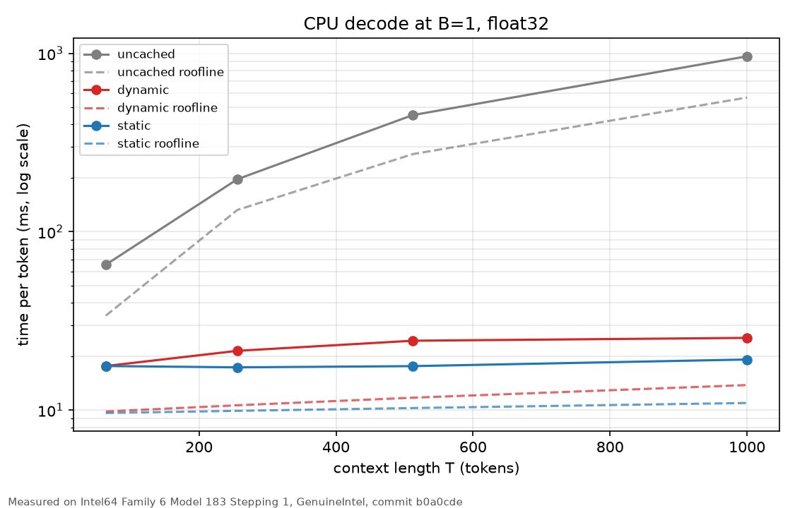
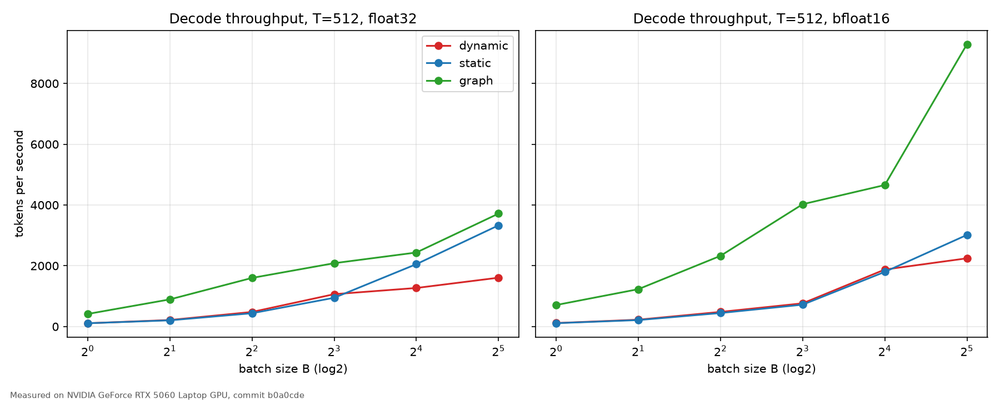
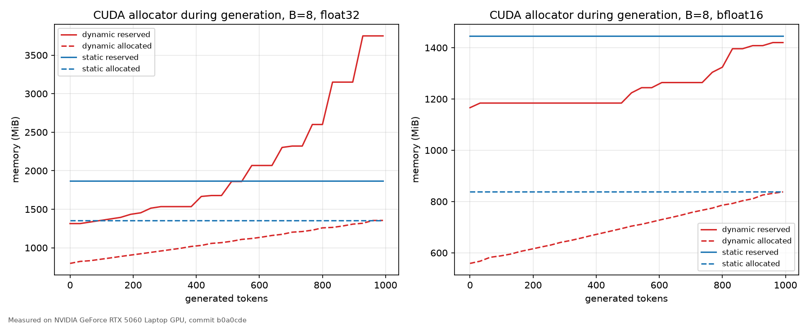
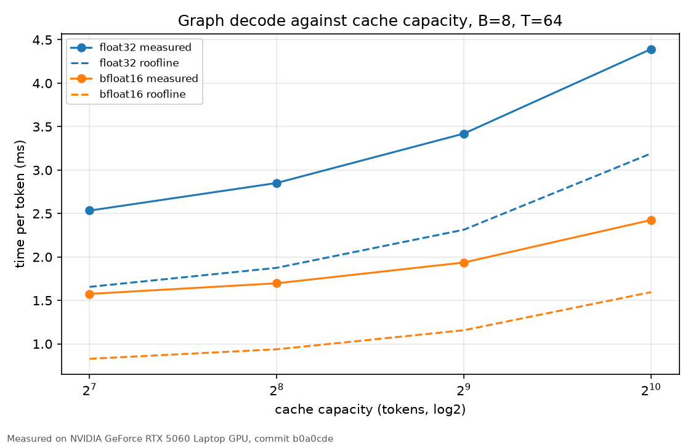
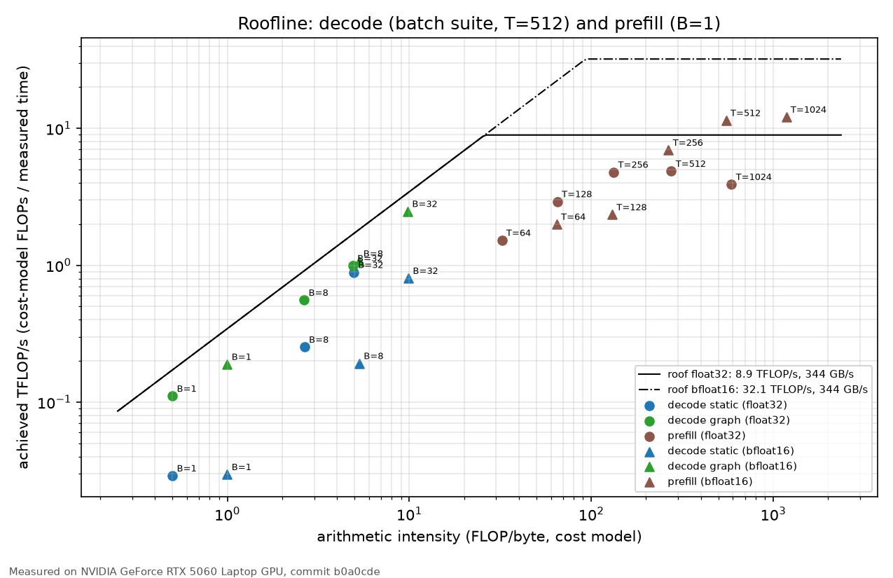

# KV Cache From Scratch


**A from-scratch KV cache for GPT-2 small, verified token by token against Hugging Face — and the story of a 9 ms floor that had nothing to do with the cache.**

## TL;DR

On a laptop GPU, eager decoding is limited neither by memory nor by compute, but by the CPU launching hundreds of small operations per token. A preallocated cache makes the decode step capturable in a CUDA graph, and capture removes that floor: same weights, same tokens, a fraction of the time.

| GPU decode, batch 1, context 512          | float32        | bfloat16       |
|-------------------------------------------|---------------:|---------------:|
| Eager, static cache                       | 9.462 ms/token | 8.906 ms/token |
| Same structure, tiny matrices (overhead)  | 9.290 ms/token | 9.632 ms/token |
| **CUDA graph**                            | **2.545 ms/token** | **1.690 ms/token** |
| Roofline lower bound for the graph        | 1.656 ms/token | 0.828 ms/token |

On the CPU, where launch overhead matters less, the cost of growing the cache with `torch.cat` shows directly: 25.403 against 19.213 ms per token at a 1000-token context.



Every number in this file is in [docs/results.md](docs/results.md), generated from the JSON files in [benchmarks/results/](benchmarks/results/), or, for superseded runs, in [ADR-0013](docs/decisions/0013-measurement-variability.md) with the commit that measured them.

## The story in four steps

1. **Build the model.** GPT-2 small, written from scratch, loading the pretrained weights. Its logits match Hugging Face within 1.6e-13 in float64.
2. **Cache it, three ways.** A dynamic cache that grows with `torch.cat`, a static cache that preallocates and writes in place, and a capturable cache that keeps its write positions on the GPU. Every variant generates exactly the same tokens as Hugging Face `generate`.
3. **Measure it, and get surprised.** The roofline, calibrated on this machine, says an eager decode step with the static cache could take 1.548 ms in float32. It takes 9.462 ms. A model with the same 12 layers and 12 heads but tiny matrices takes 9.290 ms: the time goes to the CPU launching operations, not to the GPU doing work.
4. **Capture it.** The static cache gives the decode step fixed shapes and addresses, so it can be recorded once in a CUDA graph and replayed. The step drops to 2.545 ms in float32 and 1.690 ms in bfloat16, and the host enqueues it in 0.074 ms. The remaining gap to the roofline is then chased down honestly, including one hypothesis that failed a rule fixed before looking at the data.

This project continues [transformer-from-scratch](https://github.com/FraViss/transformer-from-scratch): its greedy decoder recomputes the whole prefix at every step, which is exactly the uncached baseline measured here.

## Usage

```python
import tiktoken
import torch
from kvcache import CapturableKVCache, generate_greedy_graph, load_pretrained_gpt2

model = load_pretrained_gpt2(dtype=torch.float32, device="cuda")
enc = tiktoken.get_encoding("gpt2")
prompt = torch.tensor([enc.encode("The key-value cache makes generation faster because")],
                      device="cuda")

cache = CapturableKVCache.from_config(model.config, batch_size=1,
                                      dtype=torch.float32, device="cuda")
out = generate_greedy_graph(model, prompt, max_new_tokens=60, cache=cache)
print(enc.decode(out[0].tolist()))
```

`generate_greedy_cached` with a `DynamicKVCache` or a `StaticKVCache` runs the same decoding in eager mode, and `generate_greedy_uncached` is the baseline. tiktoken is only needed for text in and out: `uv sync --group demo`. The [demo notebook](notebooks/demo.ipynb) runs all four paths side by side.

## What is inside

- **GPT-2 small from scratch** ([src/kvcache/model.py](src/kvcache/model.py)), loading the pretrained `gpt2` safetensors checkpoint with a strict loader ([src/kvcache/weights.py](src/kvcache/weights.py)). Hugging Face `transformers` is used only as a test oracle.
- **Uncached baseline**: every step forwards the whole sequence ([src/kvcache/generation.py](src/kvcache/generation.py)).
- **Three caches behind one interface** ([src/kvcache/cache.py](src/kvcache/cache.py)):
  - `DynamicKVCache` grows by `torch.cat`.
  - `StaticKVCache` preallocates its buffers once and writes in place.
  - `CapturableKVCache` writes at token positions held in a tensor on the device and returns its whole buffer, so shapes stay constant.
- **A CUDA graph decoder** ([src/kvcache/graphs.py](src/kvcache/graphs.py)): an eager prefill, then one decode step captured once and replayed. The step feeds itself, advancing tokens, positions and the output index on the device, so replays need no work from the CPU.
- **An attention mask built from absolute positions**: key j is visible to the query at position p when j ≤ p. It is the usual causal mask on every eager path, and it hides the unwritten slots of a buffer for free.
- **A benchmark harness** ([benchmarks/](benchmarks/)): an analytic FLOP and byte model, a calibration of this machine, CUDA-event timing, and suites for decode, batch, prefill, memory, capacity and overhead.

### How it is verified

- Logits match Hugging Face within 1.6e-13 in float64.
- Cached and uncached logits match within 8.3e-13 on a 1000-token prompt.
- Greedy sequences are identical to Hugging Face `generate` token by token for the uncached path, both eager caches and the CUDA graph decoder.
- 202 fast tests (`uv run pytest`) and 12 integration tests against Hugging Face (`uv run pytest -m integration`).
- The tests were themselves tested: deliberate bugs (a wrong mask offset, positions shifted only in attention, a cache returning its whole buffer, a write index that never advances) were introduced one at a time to confirm that the suite fails.

See [Correctness in docs/results.md](docs/results.md#correctness).

## Background

**Why a cache.** Without one, decoding token t forwards all t tokens again, so each step costs more as the context grows. With a cache, each layer stores the keys and values of past tokens, and a decode step forwards one token and attends over the stored ones.

**Prefill and decode.** The prefill forwards the prompt once and fills the cache: large matmuls, limited by compute. Each decode step forwards one token per sequence: every weight is read once to do a few FLOPs, so at small batch sizes the step is limited by memory bandwidth, or, as measured here, by launch overhead.

**Memory per token.** Keys plus values for one token cost

```
2 · n_layer · n_embd · bytes_per_element = 2 · 12 · 768 · 4 = 73,728 bytes = 72 KiB  (float32)
```

so a full 1024-token context is 72.0 MiB per sequence in float32 and 36.0 MiB in bfloat16.

**Roofline.** A step can be no faster than

```
time ≥ max(FLOPs / peak FLOP/s, bytes moved / memory bandwidth)
```

FLOPs and bytes come from [benchmarks/costs.py](benchmarks/costs.py). The peak and the bandwidth are measured on this machine ([benchmarks/calibrate.py](benchmarks/calibrate.py)), not taken from a datasheet: 344.2 GB/s read bandwidth, 8.938 TFLOP/s in float32 and 32.099 TFLOP/s in bfloat16 on the GPU.

## Results

All measurements on one machine:

- **GPU:** NVIDIA GeForce RTX 5060 Laptop GPU, 8 GB (compute capability 12.0, driver 610.74).
- **CPU:** Intel Core i7-13650HX (14 cores, 20 threads), 32 GB RAM.
- **Software:** Windows 11, Python 3.12.13, PyTorch 2.11.0+cu128 (CUDA 12.8), with TF32 off (`float32_matmul_precision = "highest"`).

Times are medians. The method (CUDA events, interleaved variants, untimed setup) is in [ADR-0009](docs/decisions/0009-benchmark-methodology.md). Full tables with the source file and the measuring commit of each number are in [docs/results.md](docs/results.md).

### Decode on the GPU



- **Uncached** decode grows with the context, from 8.208 ms at T=64 to 72.988 ms at T=1000 in float32.
- **Eager cached** decode stays flat around 9 ms per token whatever the context (8.589–10.048 ms in float32), well above its roofline (1.452–2.084 ms).
- **The CUDA graph** brings the step to 2.194–2.548 ms in float32 and 1.535–1.695 ms in bfloat16. Its cost is nearly independent of T, because it always reads the whole buffer.
- **Sequences:** in float32 all four variants produce the same tokens at every T. In bfloat16 several sequences differ between variants, which is why token identity is only checked at one precision ([ADR-0009](docs/decisions/0009-benchmark-methodology.md)).

### Decode on the CPU



On the CPU the cache pays off at once: at T=1000 the uncached step takes 962.456 ms against 19.213 ms with the static cache. Here the cost of `torch.cat` is visible. At T=64 the two caches are equal (17.666 and 17.667 ms), and at T=1000 the dynamic cache takes 25.403 ms against 19.213 ms, because every step copies the whole past.

### Where a decode step goes

At B=1 and T=512 (figure at the top of this page):

- **Eager, float32:** the 9.462 ms step is 9.290 ms of CPU overhead (the structural model in eager mode) plus 0.172 ms.
- **Eager, bfloat16:** the structural model (9.632 ms) is slower than the real one (8.906 ms), so the "rest" is negative (−0.726 ms): the overhead measurement is noisier than the GPU work it hides.
- **Graph, float32:** the 2.545 ms step is a 0.419 ms kernel floor, 1.437 ms of weight reads and 0.219 ms of cache reads at the calibrated bandwidth, and a 0.470 ms residual.
- **Graph, bfloat16:** the residual is 0.456 ms.

### Batch throughput



- At batch size 1 the graph decodes 415 tokens/s against 109 for the static cache in float32, and 709 against 111 in bfloat16.
- At B=32 the graph reaches 3717 tokens/s in float32 and 9291 in bfloat16, against 3331 and 3016 for the static cache and 1608 and 2246 for the dynamic one.
- In float32 the graph's advantage shrinks with batch size, because GPU work replaces launch overhead as the limit.

### Memory



- **float32:** generating 992 tokens at batch size 8, the dynamic cache's allocated memory grows smoothly while the allocator's reserved memory climbs in steps to 3750.0 MiB. The static cache allocates once and stays at 1866.0 MiB reserved, for almost the same allocated memory (1402.9 against 1406.3 MiB).
- **bfloat16:** the effect did not appear (1420.0 against 1446.0 MiB reserved): the extra reservation of the dynamic cache is not systematic.

### Graph cost against capacity



The captured step reads and attends over the whole buffer, so its cost follows the capacity, not the tokens written. At batch size 8, with the same 64-token context and 16 steps, the step takes 2.534 ms with a 128-token buffer and 4.393 ms with a 1024-token buffer in float32 (1.575 and 2.425 ms in bfloat16). The roofline predicts the same trend (1.656 to 3.191 ms in float32). Constant shapes are not free.

### Roofline



- **Decode** sits far left at low arithmetic intensity: 0.50 FLOP/byte at B=1 in float32, rising to 4.95 at B=32. It stays below the bandwidth roof.
- **The graph** raises achieved throughput at every batch size: 0.111 against 0.029 TFLOP/s at B=1 in float32.
- **Prefill** sits in the compute-bound region and reaches 4.864 TFLOP/s in float32 at T=512 and 12.097 TFLOP/s in bfloat16 at T=1024, well under the calibrated peaks.

## What the measurements taught

- **On the GPU, eager decode is limited by the CPU, not by memory.** The structural model, with the same 12 layers and 12 heads but tiny matrices, takes as long as GPT-2 small (9.290 against 9.462 ms per token in float32). Faster memory or a smaller cache would not move that number.
- **The static cache is what makes capture possible, and capture removes the floor.** A graph needs fixed shapes and addresses, which concatenation cannot give. In the graph, the host enqueues a step in 0.074 ms, and the structural model's floor drops to 0.419 ms.
- **Constant shapes have a price proportional to capacity.** The captured step reads and attends over its whole buffer, so an oversized buffer costs time on every step.
- **A dynamic cache can reserve far more than it allocates.** In float32 at B=8 it ends with almost the same allocated memory as the static cache but about twice the reserved memory; in bfloat16 the same comparison did not show that gap.
- **Calibrate with the real shapes, and watch the L2.** At B=32 the float32 decode matmuls reach 1.575–2.986 TFLOP/s against an 8.938 TFLOP/s peak measured on a square 4096×4096 matmul. Repeating one small matmul keeps its weight in L2, and the bandwidth curve reaches 824.4 GB/s at 16 MiB, above the 344.2 GB/s DRAM read bandwidth. Such a calibration overstates how fast the decode reads its 495 MB of weights ([ADR-0013](docs/decisions/0013-measurement-variability.md)).
- **This machine varies, and the cause was not identified.** The same captured graph in float32 runs at two levels: 2.194–2.548 ms in the decode suite and up to 2.710 ms in the isolation run. Alternating with eager work does not explain the levels, and a logged memory-clock hypothesis was not confirmed by a rule fixed in advance ([ADR-0013](docs/decisions/0013-measurement-variability.md)). Float32 graph timings should be read as a range.
- **Generated sequences of a small random model are a weak oracle.** Several deliberate bugs left the tokens of the small test model unchanged: a cache returning its whole unmasked buffer, or positions shifted only in attention, which is harmless at one token per step. Only logit comparisons caught them, so the tests compare logits, not only tokens.
- **A prediction written down before measuring is worth keeping.** [ADR-0010](docs/decisions/0010-cuda-graph-decode-milestone.md) recorded, before any graph was captured, a bandwidth-bound prediction for graph decode, nearly constant in the context length.
  - Constancy held: 2.541–2.548 ms for T = 64…768 in float32.
  - The level did not: the measured step sits above the graph roofline (1.656 ms in float32, 0.828 ms in bfloat16) by about the kernel floor plus a residual of about 0.46 ms.
  - The bandwidth-based decomposition (kernel floor plus weights and cache read at the calibrated DRAM bandwidth) predicts about 2.08 ms in float32. An earlier isolation run, recorded at commit e71febc (ADR-0013), measured the same captured graph at 2.17 ms, within 5% of it; the current runs sit mostly at the slower level, about 0.47 ms above it, and the difference between the two levels is the unexplained variability above. In bfloat16 the residual of about 0.46 ms is not explained.

## Possible extensions

- A block allocator for the cache, in the style of PagedAttention, with mixed-length batches.
- A Llama-style model (RoPE, grouped-query attention), where the cache stores rotated keys and fewer key/value heads cut its size.
- Quantized keys and values, to lower the bandwidth floor that batching cannot remove.

## Limitations

- **One machine:** a Windows laptop with an RTX 5060 Laptop GPU. Its power and clock states cannot be locked without administrator rights, and they vary ([ADR-0013](docs/decisions/0013-measurement-variability.md)).
- **One model:** GPT-2 small, with learned absolute positions, standard multi-head attention, no RoPE and no GQA.
- **Greedy decoding only**, with batches of equal-length prompts. Padding, mixed lengths and a block allocator are deferred ([ADR-0002](docs/decisions/0002-core-scope-and-deferred-serving.md), [ADR-0006](docs/decisions/0006-generation-contract.md)).
- **The bfloat16 graph residual** (about 0.46 ms per token at B=1) is not explained.
- **Token identity is only meaningful at one precision.** Correctness is established in float64; benchmark sequences in bfloat16 differ between variants in several cases.

## Reproduce

```bash
uv sync                                    # Python 3.12, PyTorch cu128, dev and bench groups
uv run pytest                              # fast tests
uv run pytest -m integration               # Hugging Face equivalence (downloads ~550 MB once)

uv run python -m benchmarks.calibrate --device all
uv run python -m benchmarks.run --suite all --device cuda --dtype float32
uv run python -m benchmarks.run --suite all --device cuda --dtype bfloat16
uv run python -m benchmarks.run --suite decode --device cpu --dtype float32
uv run python -m benchmarks.run --suite prefill --device cpu --dtype float32
uv run python -m benchmarks.run --suite graph_isolation --device cuda --dtype float32
uv run python -m benchmarks.run --suite graph_isolation --device cuda --dtype bfloat16
uv run python -m benchmarks.run --suite shapes --device cuda --dtype float32
uv run python -m benchmarks.run --suite shapes --device cuda --dtype bfloat16

uv run --group bench python -m benchmarks.plots   # docs/figures/*.png from the JSON
uv run python -m benchmarks.summary               # docs/results.md from the JSON

uv run --group demo jupyter nbconvert --to notebook --execute --inplace notebooks/demo.ipynb
```

Benchmarks refuse to run on a tree with uncommitted changes outside `benchmarks/results/`, and each JSON records the commit that measured it. `--allow-dirty` exists for experiments, and its results are marked as such.

## Project structure

```
src/kvcache/         model, weight loader, caches, generation, CUDA graph decoder
benchmarks/          cost model, calibration, timing harness, suites, plots, summary
benchmarks/results/  committed JSON results and the GPU clock log
tests/               unit, CUDA and integration tests
docs/                engineering log: status, decision records, results, figures
notebooks/           executed demonstration notebook
```

## Engineering log

Every design decision of this project is written down. [docs/](docs/README.md) is the logbook and [docs/status.md](docs/status.md) has the current state. Decision records:

- [0001](docs/decisions/0001-gpt2-decoder-as-base-model.md) — GPT-2 small, from scratch, as the base model
- [0002](docs/decisions/0002-core-scope-and-deferred-serving.md) — a core of milestones, with serving deferred
- [0003](docs/decisions/0003-load-weights-from-safetensors.md) — weights from safetensors, `transformers` only as an oracle
- [0004](docs/decisions/0004-float64-for-correctness-tests.md) — float64 for correctness tests
- [0005](docs/decisions/0005-token-id-api-and-tokenizer.md) — token-id API; tiktoken only for demos
- [0006](docs/decisions/0006-generation-contract.md) — greedy, exactly N tokens, no sliding window, equal-length batches
- [0007](docs/decisions/0007-mutable-kv-cache-interface.md) — a mutable cache object with `update`
- [0008](docs/decisions/0008-preallocated-static-kv-cache.md) — the preallocated static cache
- [0009](docs/decisions/0009-benchmark-methodology.md) — benchmark methodology
- [0010](docs/decisions/0010-cuda-graph-decode-milestone.md) — the CUDA graph milestone and its recorded prediction
- [0011](docs/decisions/0011-position-based-attention-mask.md) — the attention mask built from absolute positions
- [0012](docs/decisions/0012-capturable-cache-and-graph-decoder.md) — the capturable cache and the graph decoder
- [0013](docs/decisions/0013-measurement-variability.md) — measurement variability and what it rules out

## License

MIT, see [LICENSE](LICENSE).
